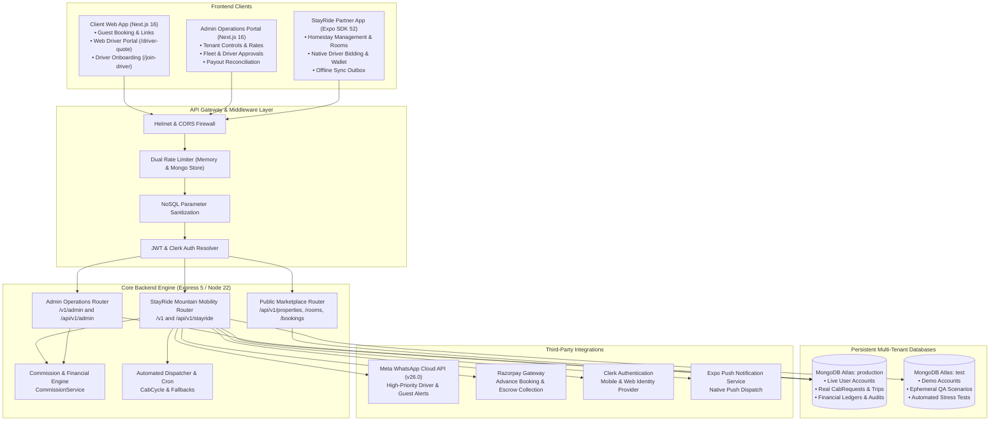

# StayCabs Codebase Architecture & Technical Blueprint

**Document ID:** `QA/01_CODEBASE_ARCHITECTURE`  
**Revision Date:** 2026-11-06  
**Architect:** Principal Software Architect (Agent 1)  

---

## 1. System Ecosystem & Topology

The StayCabs platform is a distributed mountain-mobility and homestay hospitality ecosystem serving three primary stakeholder classes:
1. **Guests / Travelers**: Mountain tourists seeking homestay bookings, airport/railway transfers, sightseeing cabs, and multi-day packages.
2. **Homestay Hosts / Owners**: Estate and homestay managers coordinating guest check-ins, local driver fleets, and ride referrals.
3. **Cab Drivers**: Local hill drivers operating individually or in taxi syndicates/unions, accepting trips via WhatsApp web links or native mobile apps.
4. **Platform Operations / Admins**: Super-administrators managing commission structures, driver approvals, dispute arbitration, payment claims, and automated settlements.

---

## 2. Directory Layout & Module Ownership

| Directory | Framework / Runtime | Purpose & Scope |
| :--- | :--- | :--- |
| `my-code/client-side/` | Next.js 16 (App Router, Turbopack, Tailwind) | Public guest-facing web marketplace, cab request booking form (`/cab-request`), driver onboarding (`/join-driver`), and web driver quoting/wallet portal (`/driver-quote`). |
| `my-code/admin-side/` | Next.js 16 (App Router, Tailwind) | Internal operations portal for system administrators: user management, driver KYC approval, manual driver dispatch, payment claim verification, commission configuration, and payout settlements. |
| `my-code/stayride-expo/` | React Native 0.76 / Expo SDK 52 (Expo Router) | Native cross-platform mobile application for homestay hosts (calendar sync, rooms, guests, own-fleet management) and registered native drivers (bidding, active trip tracking, sovereign wallet). |
| `my-code/server/` | Node.js 22 / Express 5 / Mongoose 8 | Central REST API backend, multi-tenant database router, financial calculation engine, scheduled cron jobs, and third-party webhook handlers. |
| `my-code/server/src/stayride/` | TypeScript | Mountain mobility domain module: `platform.ts` (business core, state machine), `routes.ts` (API handlers), `store.ts` (tenant persistence), `messages.ts` (WhatsApp templates), `ical.ts` (calendar sync). |

---

## 3. Request-Response Lifecycle Traces

### Trace A: Guest Cab Request Submission
1. **User Action**: Guest lands on `https://staycabs.in/cab-request?token=GL-...` or searches routes directly on `/cab-request`. Fills pickup address, drop destination, date, time, passenger count, vehicle category, and optional target budget. Clicks "Request Cab".
2. **Frontend Call**: `client-side/app/cab-request/page.tsx` executes `POST https://api.staycabs.in/v1/public/guest-links/:token/cab-requests` (or `/public/properties/:slug/cab-requests`) attaching Google reCAPTCHA v3 token.
3. **Gateway Middleware**:
   - Helmet sets strict cross-origin policies.
   - CORS verifies origin header against whitelist.
   - `strictLimiter` checks IP limit (30 requests per 15 min window).
   - `mongoSanitize` strips dangerous `$`/`.` injection keys.
   - `requireRecaptcha('guest_cab_request')` validates token with Google API.
4. **Router & Controller**:
   - `routes.ts:1127` resolves guest link token via `getGuestLinkModel`.
   - Validates homestay tenant state (ensures host is not blocked and feature `guestCabLinks` is active).
5. **Service & State Machine**:
   - `platform.ts` generates unique reference code `REQ-XXXXXXXXXX`.
   - Populates destination coordinates, normalized `homestayArea`, and initializes status as `FINDING_DRIVER` (or `PENDING_REVIEW` if dispatch requires manual host approval).
   - Calculates bidding closing deadline based on `quoteBiddingWindowMin`.
6. **Database Write**:
   - Persists document to `cabrequests` collection in `production` (or `test` if host is demo account) using `tenantDbModel`.
   - Generates audit entry in `auditlogs`.
7. **Side Effects & Notifications**:
   - Queries `users` for active, nearby, approved drivers matching vehicle category.
   - Dispatches Meta WhatsApp Cloud API template `new_trip_request` with signed driver bidding link (`https://staycabs.in/driver-quote?req=REQ-...&d=...`).
   - If driver has registered Expo push token, fires high-priority native notification.
8. **Frontend Response**:
   - Returns `{ success: true, reference: "REQ-...", status: "FINDING_DRIVER" }`.
   - Web client transitions to real-time status tracker polling `/v1/public/cab-requests/:reference`.

---

### Trace B: Driver Quote Submission & Bidding
1. **User Action**: Driver taps WhatsApp alert link or opens Expo app, views trip details (pickup, drop, distance, passengers, vehicle requested), and inputs proposed all-inclusive fare (e.g. ₹2,800).
2. **Frontend Call**: Driver client executes `POST /v1/public/driver-quote/quote` (or `/driver/trips/:reference/quote` in Expo with Bearer token).
3. **Controller & Service**:
   - `routes.ts:1482` verifies driver token or credentials.
   - Validates driver account status (`ACTIVE` only; `PENDING_APPROVAL` or `BLOCKED` drivers are rejected with 403).
   - Asserts bidding window has not elapsed (`biddingClosesAt > now`).
4. **State Machine (`driverSubmitQuote`)**:
   - Checks if driver already has an active quote; updates existing or appends new quote.
   - If auto-accept conditions are configured and quote meets threshold, triggers instant hold.
   - Updates `CabRequest.status` to `QUOTE_RECEIVED`.
5. **Database Write**:
   - Atomic `findOneAndUpdate` on `cabrequests` with optimistic status check.
   - Appends quote to embedded `quotes` array.
6. **Notifications**:
   - Host receives push notification / WhatsApp alert notifying of new competitive quote.
   - Guest status tracker reflects received quote count.

---

### Trace C: Quote Acceptance & Advance Payment
1. **User Action**: Host or Guest accepts winning quote of ₹2,800.
2. **Backend Processing (`ownerConfirmQuote`)**:
   - Calls `CommissionService.calculateSplit(2800, propertyId)`:
     - Platform Fee (e.g. 5%): ₹140
     - Homestay Host Commission (e.g. 10%): ₹280
     - Total Commission: ₹420
     - Advance Required (e.g. 15%): ₹420 (floored by `minAdvanceAmount`)
     - Remaining Cash to Driver: ₹2,380
     - Driver Share of Advance: ₹0
   - Freezes calculation permanently into `financialSnapshot`.
   - Transitions status to `AWAITING_ADVANCE_PAYMENT`.
   - Sets `advanceDueAt` timer (e.g. 30-60 minutes).
   - Generates Razorpay payment link or displays verified UPI QR.
3. **Payment Completion**:
   - Razorpay Webhook `payment.captured` arrives at `/v1/webhooks/razorpay`.
   - Webhook signature is validated using HMAC SHA256 against `RAZORPAY_WEBHOOK_SECRET`.
   - `applyAdvancePayment` executes atomically:
     - Marks `advancePaid = true`.
     - Generates cryptographically random 4-digit boarding PIN (`pickupOtp`).
     - Transitions status to `CONFIRMED`.
4. **Dispatch Side Effects**:
   - Dispatches Meta WhatsApp template `cab_booking_confirmed` to Guest with trip pass link.
   - Dispatches Meta WhatsApp template `driver_trip_confirmed` to Driver with pickup address, guest name, contact, and remaining cash collection note (₹2,380).

---

### Trace D: Trip Execution, Boarding PIN & Completion
1. **Pickup & Boarding PIN**:
   - Driver reaches pickup location, meets guest.
   - Driver enters guest's 4-digit boarding PIN into app/web link (`POST /v1/driver/trips/:reference/start`).
   - Backend checks PIN:
     - If incorrect: increments `pickupOtpAttempts`. If attempts reach 5, locks PIN entry to prevent brute-force attacks.
     - If correct: transitions status to `TRIP_STARTED` and stamps `startedAt = now()`.
2. **Trip Completion (`completeTrip`)**:
   - Driver taps "Complete Ride" (`POST /v1/driver/trips/:reference/complete`).
   - Guest pays remaining cash (₹2,380) directly to driver.
   - Backend transitions status to `COMPLETED`.
   - If `driverShareOfAdvance > 0`, releases funds to Driver's sovereign wallet balance (`driverSettlementStatus = PENDING`).
   - Releases Homestay host commission to Host payout pool (`hostPayoutId = null`).

---

### Trace E: Driver Wallet Settlement & Payout
1. **User Action**: Driver requests withdrawal of accumulated wallet balance (`POST /v1/driver/payouts/request`).
2. **Backend Validation (`requestDriverPayout`)**:
   - Enforces `minDriverPayoutThreshold` (e.g. ₹100 minimum).
   - Verifies driver has zero pending payouts (`one_pending_payout_per_driver` index).
   - Locks eligible trips atomically by updating `driverPayoutId = newPayoutId`.
   - Creates `PayoutRequest` in `PENDING` state with payout destination (UPI ID or Bank Account).
3. **Admin Settlement**:
   - Admin verifies transfer via bank portal and inputs UTR number (`POST /v1/admin/driver-payouts/:id/settle`).
   - Backend stamps `status = SETTLED`, records UTR and settlement timestamp.
   - Marks locked trips `driverSettlementStatus = SETTLED`.
   - Fires WhatsApp notification to driver confirming transfer.

---

## 4. Architectural Boundaries & Data Isolation Rules

1. **Strict Multi-Tenant Database Separation**:
   - Production workloads connect strictly to Atlas `production` database.
   - Demo / test workloads connect strictly to Atlas `test` database.
   - Neither database may share connection state without explicitly passing `isDemo` flag to `tenantDbModel()`.
2. **Zero In-Memory Fallback in Production**:
   - `config/db.ts` enforces that if `isDeployed === true`, a missing `MONGODB_URI` crashes fast with a fatal 503 error, preventing ephemeral data creation.
3. **Idempotent State Mutations**:
   - Every status transition must use Mongoose `findOneAndUpdate` with an exact precondition filter (`{ _id: id, status: EXPECTED_STATE }`).
   - Unconditional writes or read-modify-write patterns that risk race conditions are strictly prohibited.
4. **Financial Snapshot Immutability**:
   - Once a quote is accepted and `financialSnapshot` is frozen, subsequent rate or commission setting changes by admins MUST NOT alter the frozen snapshot of existing bookings.
