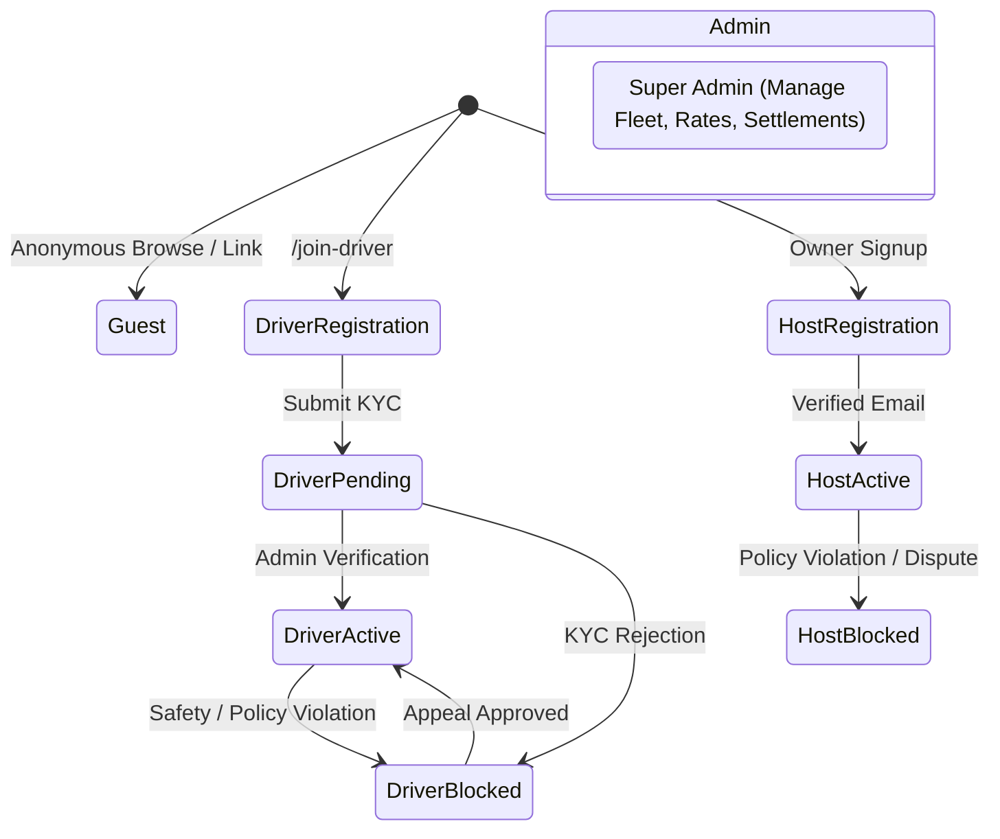

# StayCabs User Roles, Permissions & RBAC Matrix

**Document ID:** `QA/02_USER_ROLES_AND_PERMISSIONS`  
**Revision Date:** 2026-11-06  
**Auditor:** Security & Access Control Auditor (Agent 10)  

---

## 1. System Role Taxonomy

The StayCabs platform enforces four distinct user roles, augmented by lifecycle account states and cryptographic token boundaries.

### Detailed Role Definitions

| Role Identifier | Primary Client Surfaces | Account Lifecycle States | Core Responsibilities |
| :--- | :--- | :--- | :--- |
| **`guest`** | Next.js Web (`/cab-request`, `/checkout`, `/stays/*`) | Ephemeral / Non-registered, or authenticated traveler | Submits ride requests, reviews quotes, pays advance deposits via Razorpay/UPI, provides boarding PIN to driver, submits trip ratings. |
| **`driver`** | Next.js Web (`/driver-quote`), Expo App (`DriverTripsScreen`, `DriverEarningsScreen`) | `PENDING_APPROVAL`, `ACTIVE`, `BLOCKED` | Receives broadcast ride requests, submits quotes, accepts counter-offers, starts trip via boarding PIN, collects cash balance, manages sovereign wallet, requests payouts. |
| **`owner`** | Expo App (`HomeScreen`, `CabsScreen`, `RoomsScreen`), Web (`/h/[slug]`) | `ACTIVE`, `BLOCKED` | Manages homestay rooms and calendar sync (iCal), issues guest cab links, dispatches requests, reviews driver quotes, issues counter-offers, assigns own fleet, withdraws host commission. |
| **`admin`** | Next.js Admin Portal (`/`, `/login`) | `ACTIVE` | Master system control: approves/rejects driver registrations, arbitrates payment claims, overrides driver assignments, settles host and driver payouts, modifies platform commission parameters, views audit logs. |

---

## 2. Authentication & Credential Resolution

StayCabs employs a hybrid multi-layer authentication architecture:

1. **Internal JWT Engine (`server/src/middlewares/auth.ts`)**:
   - Signs tokens containing `{ id, role, email, tokenVersion, isDemo }`.
   - Validates signature against `JWT_SECRET`.
   - Enforces `tokenVersion` matching: every password reset, session logout, role update, or admin revocation increments `User.tokenVersion`, instantly invalidating existing JWTs across all devices.
2. **Clerk Authentication Bridge (`/auth/clerk-sync`)**:
   - Mobile and web users authenticate via Clerk SSO (Phone OTP, Google OAuth, Email).
   - Backend verifies Clerk session token via `@clerk/backend`, extracts email/phone, synchronizes or creates local `User` record, and returns platform JWT.
3. **Signed Guest-Link Tokens (`GL-...`)**:
   - Opaque cryptographically random tokens issued by homestay hosts (`guestlinks` collection).
   - Allows guests to create cab requests tied to the host's property without creating a formal user account.
4. **Driver Quote Deep-Link Tokens**:
   - URL parameters (`?req=REQ-...&d=<driverId>`) dispatched via Meta WhatsApp Cloud API.
   - Authorizes the driver to view trip specs and submit quotes for that specific request without requiring pre-login friction.

---

## 3. Role-Based Access Control (RBAC) Matrix

| Endpoint Group | Route Pattern | Guest | Driver (Pending) | Driver (Active) | Host / Owner | Platform Admin |
| :--- | :--- | :---: | :---: | :---: | :---: | :---: |
| **Public Config & Legal** | `GET /v1/public/config` `GET /v1/public/legal/:doc` | ALLOW | ALLOW | ALLOW | ALLOW | ALLOW |
| **Guest Cab Request** | `POST /v1/public/guest-links/:token/cab-requests` `POST /v1/public/properties/:slug/cab-requests` | ALLOW (Recaptcha) | DENY | DENY | DENY | ALLOW |
| **Public Request Status** | `GET /v1/public/cab-requests/:reference` | ALLOW | ALLOW | ALLOW | ALLOW | ALLOW |
| **Guest Payment Claim** | `POST /v1/public/cab-requests/:reference/payment-claim` | ALLOW | DENY | DENY | DENY | ALLOW |
| **Guest Rating** | `POST /v1/public/cab-requests/:reference/rate` | ALLOW | DENY | DENY | DENY | ALLOW |
| **Driver Registration** | `POST /v1/public/driver-signup` | ALLOW (Recaptcha) | ALLOW | ALLOW | ALLOW | ALLOW |
| **Driver Quoting (Web)** | `POST /v1/public/driver-quote/quote` | DENY | DENY (403) | ALLOW | DENY | ALLOW |
| **Driver Trip Start** | `POST /v1/public/driver-quote/start` `POST /v1/driver/trips/:reference/start` | DENY | DENY (403) | ALLOW (Assigned Only) | DENY | ALLOW |
| **Driver Trip Complete**| `POST /v1/public/driver-quote/complete` `POST /v1/driver/trips/:reference/complete` | DENY | DENY (403) | ALLOW (Assigned Only) | DENY | ALLOW |
| **Driver Sovereign Wallet**| `GET /v1/driver/wallet` `GET /v1/public/driver-quote/wallet` | DENY | DENY (403) | ALLOW (Own Wallet Only) | DENY | ALLOW |
| **Driver Payout Request**| `POST /v1/driver/payouts/request` | DENY | DENY (403) | ALLOW (Own Wallet Only) | DENY | ALLOW |
| **Homestay Cab Dispatch**| `POST /v1/trips/:id/dispatch` | DENY | DENY | DENY | ALLOW (Property Tenant) | ALLOW |
| **Host Counter-Offer** | `POST /v1/trips/:id/counter` | DENY | DENY | DENY | ALLOW (Property Tenant) | ALLOW |
| **Assign Own Fleet** | `POST /v1/trips/:id/assign` | DENY | DENY | DENY | ALLOW (Property Tenant) | ALLOW |
| **Host Commission Payout**| `POST /v1/payouts/request` | DENY | DENY | DENY | ALLOW (Property Tenant) | ALLOW |
| **Admin Driver Approval**| `PATCH /v1/admin/stayride/drivers/:id/status` | DENY | DENY | DENY | DENY | ALLOW |
| **Admin Payout Settle** | `POST /v1/admin/driver-payouts/:id/settle` `POST /v1/admin/host-payouts/:id/settle` | DENY | DENY | DENY | DENY | ALLOW |
| **Admin Force Reassign**| `POST /v1/admin/cab-requests/:id/assign-driver` | DENY | DENY | DENY | DENY | ALLOW |
| **Admin Commission Rates**| `PUT /v1/admin/commission/settings` | DENY | DENY | DENY | DENY | ALLOW |
| **Admin Audit Trail** | `GET /v1/admin/audit-log` | DENY | DENY | DENY | DENY | ALLOW |

---

## 4. Cross-Tenant Data Isolation & Security Invariants

1. **Tenant Email Scoping (`tenantKey`)**:
   - Every homestay request is bound to `propertyId` representing the owner's primary email address.
   - Homestay API operations verify that the authenticated caller matches `propertyId` or possesses `role === 'admin'`. Cross-tenant mutations return `403 Forbidden`.
2. **Driver Isolation & Masking**:
   - Unassigned drivers cannot view passenger phone numbers or full guest details.
   - Drivers can only see passenger contact information AFTER trip status transitions to `CONFIRMED` or `TRIP_STARTED`.
   - Driver quote amounts submitted by competitors are completely hidden from competing drivers (blind auction).
3. **Boarding PIN Secrecy**:
   - The 4-digit boarding PIN (`pickupOtp`) is visible ONLY to the paying guest and the hosting property owner.
   - The assigned driver must obtain the PIN in person from the passenger upon vehicle boarding.
   - PIN entry is throttled to 5 attempts maximum (`pickupOtpAttempts`); exceeding 5 attempts locks the request for safety arbitration.
