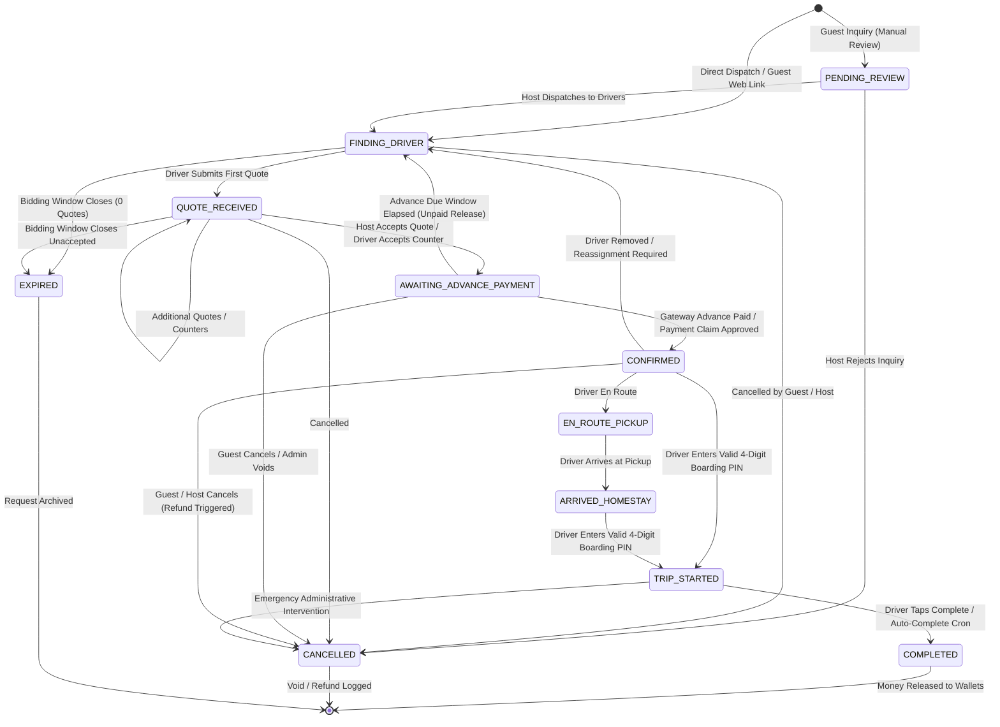

# StayCabs Business Rules, Policies & Domain Logic Engine

**Document ID:** `QA/03_BUSINESS_RULES`  
**Revision Date:** 2026-11-06  
**Auditor:** Business Logic Analyst & Rules Engine Lead (Agent 2)  

---

## 1. Cab Request State Machine & Invariants

---

## 2. Core Business Domains & Operational Rules

### Domain 1: Driver Bidding & Quoting Policies
- **BR-BID-01 (Blind Bidding)**: Drivers never see the monetary quotes submitted by competitors. Only trip parameters (pickup, drop, distance, passengers, vehicle requested, optional guest budget) are revealed.
- **BR-BID-02 (Account Gate)**: Only drivers with `accountStatus === 'ACTIVE'` may submit quotes. Drivers with `PENDING_APPROVAL` receive `403 FORBIDDEN (DRIVER_PENDING_APPROVAL)`. Drivers with `BLOCKED` receive `403 FORBIDDEN (ACCOUNT_BLOCKED)`.
- **BR-BID-03 (Bidding Window)**: Bidding remains open until `biddingClosesAt` (derived from `quoteBiddingWindowMin`, default 240 minutes / 4 hours). Submissions after this deadline return `400 BAD_REQUEST (BIDDING_CLOSED)`.
- **BR-BID-04 (Quote Re-bidding)**: A driver may update their existing quote at any time before acceptance, overwriting their previous proposed fare.
- **BR-BID-05 (Host Counter-Offers)**: Homestay hosts may propose a counter-offer (`counterFare`) on any pending driver quote. The driver receives a WhatsApp notification and has the option to `ACCEPT_COUNTER` (which immediately transitions the request to `AWAITING_ADVANCE_PAYMENT` at the counter fare) or retain their original quote.

---

### Domain 2: Financial Split & Commission Engine
- **BR-FIN-01 (Rupee Conservation)**: For every completed trip, the agreed fare must exactly equal the sum of Platform Fee, Homestay Commission, and Driver Net Take-Home:
  $$\text{Agreed Fare} = \text{Platform Fee} + \text{Homestay Commission} + \text{Driver Payout Amount}$$
- **BR-FIN-02 (Advance Requirement)**: The online advance collected from the guest covers the platform fee and homestay host commission, respecting the minimum floor:
  $$\text{Advance Amount} = \min(\text{Agreed Fare}, \max(\text{Min Advance Floor}, \text{Total Commission}, \text{Agreed Fare} \times \text{Advance Rate}))$$
- **BR-FIN-03 (Driver Share of Advance)**: If the advance collected exceeds total commission ($\text{Advance} > \text{Total Commission}$), the surplus is credited to the Driver's sovereign wallet as `driverShareOfAdvance`:
  $$\text{driverShareOfAdvance} = \max(0, \text{Advance Amount} - \text{Total Commission})$$
- **BR-FIN-04 (Cash Collected in Hand)**: The remaining balance is paid directly in cash or UPI by the guest to the driver upon ride arrival:
  $$\text{remainingCashToDriver} = \max(0, \text{Agreed Fare} - \text{Advance Amount})$$
- **BR-FIN-05 (Net Driver Take-Home)**:
  $$\text{driverPayoutAmount} = \text{remainingCashToDriver} + \text{driverShareOfAdvance} = \text{Agreed Fare} - \text{Total Commission}$$
- **BR-FIN-06 (Snapshot Freezing)**: Once a quote or counter is accepted, all monetary figures are calculated and frozen in `financialSnapshot`. Changes to global commission rates never affect existing snapshots.

---

### Domain 3: Advance Payment Escrow & Expiration
- **BR-ESC-01 (Advance Expiration Timer)**: When a request enters `AWAITING_ADVANCE_PAYMENT`, an `advanceDueAt` timestamp is set (typically 30–60 minutes).
- **BR-ESC-02 (Lazy Unpaid Release)**: If `advanceDueAt` passes without payment, background cron or platform read transitions the request back to `FINDING_DRIVER`, unholds the confirmed driver, revives other quotes, and notifies the host.
- **BR-ESC-03 (Manual UPI Claim)**: A guest paying via UPI QR can submit their bank UTR (`paymentClaim`). The request remains held until an admin approves or rejects the claim.
- **BR-ESC-04 (Unmatched Payment Protection)**: If a gateway payment arrives for an expired or cancelled booking, the payment is logged in `unmatchedPayments` for immediate administrative refund.

---

### Domain 4: Boarding PIN (OTP) & Verification
- **BR-PIN-01 (PIN Generation)**: Upon successful advance payment, a cryptographically random 4-digit PIN (`pickupOtp`) is generated.
- **BR-PIN-02 (PIN Distribution)**: The PIN is displayed strictly on the guest's trip pass and the host's dashboard. It is NEVER sent to the driver via WhatsApp or API.
- **BR-PIN-03 (Boarding Validation)**: To transition the trip to `TRIP_STARTED`, the driver must obtain and submit the passenger's 4-digit PIN.
- **BR-PIN-04 (Brute-Force Lockout)**: If a driver inputs an incorrect PIN 5 times (`pickupOtpAttempts >= 5`), PIN entry is disabled, requiring admin arbitration.
- **BR-PIN-05 (Completed Without PIN Review)**: If a trip is auto-completed by cron without the driver ever entering the boarding PIN (`completedWithoutPin === true`), the trip is placed on administrative hold (`PAYOUT_HOLD`). It is ineligible for driver or host payout until an admin investigates and marks `noPinReviewedAt`.

---

### Domain 5: Trip Completion & Auto-Completion
- **BR-CMP-01 (Driver Manual Completion)**: The assigned driver can mark the trip completed (`status = COMPLETED`) upon reaching destination.
- **BR-CMP-02 (Cron Auto-Completion)**: Background cron sweeps for trips in `TRIP_STARTED` status whose scheduled pickup time is past a predefined duration (e.g. 6-12 hours). It marks them `COMPLETED` with `autoCompleted = true`.
- **BR-CMP-03 (Completion Reminders)**: Drivers receive automated WhatsApp reminders to complete trips that have remained active past their expected duration.

---

### Domain 6: Driver Sovereign Wallet & Payouts
- **BR-WAL-01 (Wallet Earnings Eligibility)**: A trip's `driverShareOfAdvance` becomes eligible for withdrawal only when:
  - `status === 'COMPLETED'`
  - `advancePaid === true`
  - `driverSettlementStatus === 'PENDING'`
  - `driverPayoutId === null`
  - `driverShareOfAdvance > 0`
  - Not subject to `PAYOUT_HOLD` (e.g. unreviewed no-PIN completions).
- **BR-WAL-02 (Minimum Payout Threshold)**: Payout requests require a minimum balance of `minDriverPayoutThreshold` (default ₹100).
- **BR-WAL-03 (Single Active Payout)**: A driver may have at most ONE pending payout request at any time (enforced by unique MongoDB index `one_pending_payout_per_driver`).
- **BR-WAL-04 (Atomic Payout Locking)**: When a payout request is submitted, all eligible trips are locked atomically by stamping `driverPayoutId = payoutId`.
- **BR-WAL-05 (Rejection Trip Recovery)**: If an admin rejects a payout request, all locked trips have `driverPayoutId` reset to `null`, instantly restoring the driver's available wallet balance.

---

### Domain 7: Homestay Host Commission & Fleet Dispatch
- **BR-HST-01 (Referral Commission)**: Homestay hosts earn their referral commission (`homestayCommissionAmount`) upon completion of platform trips booked for their guests.
- **BR-HST-02 (Own Fleet Exemption)**: If a host fulfills a ride using their own private vehicle and driver (`ownFleet = true`):
  - Homestay referral commission is 0% (`hcPercent = 0.0`).
  - Platform fee is discounted to `ownFleetFeePercent` (or `ownFleetMinFee`).
  - The advance required from the guest equals only the platform fee.
  - Driver collects 100% of the remaining fare directly in cash.

---

### Domain 8: Cancellation, No-Show & Refund Rules
- **BR-CNC-01 (Pre-Confirmation Cancellation)**: If a guest cancels while in `FINDING_DRIVER` or `QUOTE_RECEIVED`, no advance was charged; request closes cleanly.
- **BR-CNC-02 (Post-Confirmation Cancellation)**: If a guest cancels after advance is paid (`CONFIRMED`), `refundStatus` is flagged as `PENDING`. Admins review whether a cancellation fee applies or full refund is issued.
- **BR-CNC-03 (Passenger No-Show)**: If guest fails to arrive at pickup and driver verifies with host, admin reviews the case. If marked `noShow = true`, homestay commission and driver compensation are settled according to policy, and advance is retained.
