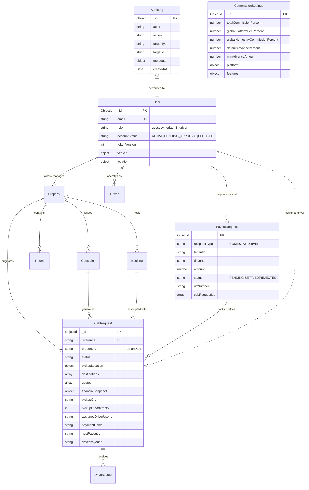

# StayCabs Database Schema, Indexes & Entity Relationships

**Document ID:** `QA/04_DATABASE_SCHEMA_AND_RELATIONSHIPS`  
**Revision Date:** 2026-11-06  
**Auditor:** Database Auditor & Schema Lead (Agent 7)  

---

## 1. Entity-Relationship Architecture



---

## 2. Exhaustive Schema & Index Directory

### 1. `cabrequests` Collection
Stores all on-demand and scheduled ride requests generated by guests, homestays, or dispatchers.
- **Key Fields**:
  - `reference`: Unique human-readable booking code (e.g. `REQ-8F12A0C4E7`).
  - `propertyId`: Homestay tenant key (email) managing the referral.
  - `status`: Enum (`PENDING_REVIEW`, `FINDING_DRIVER`, `QUOTE_RECEIVED`, `AWAITING_ADVANCE_PAYMENT`, `CONFIRMED`, `EN_ROUTE_PICKUP`, `ARRIVED_HOMESTAY`, `TRIP_STARTED`, `COMPLETED`, `CANCELLED`, `EXPIRED`).
  - `quotes`: Embedded array of `DriverQuoteSchema`.
  - `financialSnapshot`: Embedded frozen financial ledger (`agreedFare`, `advanceAmount`, `platformFeeAmount`, `homestayCommissionAmount`, `driverPayoutAmount`, `remainingCashToDriver`, `driverShareOfAdvance`).
  - `pickupOtp`: 4-digit boarding PIN (generated only when `advancePaid === true`).
  - `pickupOtpAttempts`: Guess counter; locked at 5 attempts.
  - `hostPayoutId`: Foreign key to `PayoutRequest` covering homestay host commission.
  - `driverPayoutId`: Foreign key to `PayoutRequest` covering driver advance surplus.
- **Critical Indexes**:
  - `{ reference: 1 }` (Unique)
  - `{ propertyId: 1, createdAt: -1 }`
  - `{ status: 1, date: 1 }`
  - `{ assignedDriverUserId: 1, status: 1 }`
  - `{ hostPayoutId: 1 }`
  - `{ driverPayoutId: 1 }`

---

### 2. `users` Collection
Stores identities, credentials, verification state, vehicle info, and push tokens.
- **Key Fields**:
  - `email`: Lowercase, indexed, unique.
  - `role`: Enum (`guest`, `owner`, `admin`, `driver`).
  - `accountStatus`: Enum (`ACTIVE`, `PENDING_APPROVAL`, `BLOCKED`).
  - `tokenVersion`: Incremented integer to instantly revoke active JWT sessions.
  - `clerkId`: External authentication identifier (sparse, unique).
  - `vehicle`: Embedded vehicle specs (`type`, `model`, `plate`, `seats`, `area`).
  - `driverCategory`: `INDIVIDUAL` or `UNION` (taxi stand/syndicate).
  - `location`: Last recorded GPS coordinate (`lat`, `lng`, `updatedAt`).
- **Critical Indexes**:
  - `{ email: 1 }` (Unique)
  - `{ clerkId: 1 }` (Unique, Sparse)
  - `{ role: 1, accountStatus: 1 }`

---

### 3. `payoutrequests` Collection
Manages withdrawal requests for homestay hosts and drivers.
- **Key Fields**:
  - `recipientType`: `HOMESTAY` or `DRIVER`.
  - `tenantId`: Homestay owner email (for hosts).
  - `driverId`: Driver user ID or phone (for drivers).
  - `amount`: Net withdrawal balance in INR.
  - `status`: `PENDING`, `SETTLED`, or `REJECTED`.
  - `method`: `UPI` or `BANK_TRANSFER`.
  - `utrNumber`: Bank transaction reference entered by admin upon settlement.
  - `cabRequestIds`: Array of string IDs of trips locked to this payout.
- **Critical Partial Unique Indexes**:
  - `one_pending_payout_per_tenant`: `{ tenantId: 1, status: 1 }` with partial filter `{ recipientType: 'HOMESTAY', status: 'PENDING' }`.
  - `one_pending_payout_per_driver`: `{ driverId: 1, status: 1 }` with partial filter `{ recipientType: 'DRIVER', status: 'PENDING' }`.
  - Guarantee: Neither a host nor a driver can submit concurrent duplicate payout claims.

---

### 4. `commissionsettings` Collection
Global platform financial configuration document.
- **Key Fields**:
  - `totalCommissionPercent`: Total percentage taken from driver fare (default 10%).
  - `adminSharePercentOfCommission`: Share going to platform (default 50%).
  - `homestaySharePercentOfCommission`: Share going to homestay host (default 50%).
  - `globalPlatformFeePercent`: Platform fee percentage (default 5%).
  - `globalHomestayCommissionPercent`: Homestay host referral commission (default 5%).
  - `defaultAdvancePercent`: Default deposit required from guest (default 15%).
  - `minAdvanceAmount`: Minimum cash advance floor in INR (default ₹500).
  - `platform`: Nested operational settings (`quoteBiddingWindowMin`, `minDriverPayoutThreshold`, `ownFleetFeePercent`, `ownFleetMinFee`, vehicle classes).

---

### 5. `auditlogs` Collection
Immutable, append-only compliance ledger tracking all administrative, financial, and lifecycle mutations.
- **Key Fields**:
  - `actor`: User ID, email, or `system`.
  - `action`: Dot-notation action code (e.g. `cab.advance_paid`, `driver.payout.settle`, `admin.assign_driver`).
  - `targetType`: Entity type (`CabRequest`, `PayoutRequest`, `User`, `Property`).
  - `targetId`: Target record ID.
  - `metadata`: JSON payload of change details, before/after values, and request IP.
- **Safety Note**: TTL indexes on `auditlogs` have been permanently disabled to prevent premature data purging.

---

## 3. Multi-Tenant Database Resolution Mechanics

StayCabs uses physical database partitioning on the same MongoDB Atlas cluster:
- **`production` DB**: Real live tenants, real drivers, live customer requests, and production financial ledgers.
- **`test` DB**: Demo homestay (`demo@example.com`), demo drivers (`driver@example.com`), and automated test executions.

### Resolution Code Implementation (`utils/tenant-model.ts`):
```typescript
export function tenantDbModel<T = any>(
  isDemo: boolean,
  name: string,
  schema: mongoose.Schema
): mongoose.Model<T> {
  if (mongoose.connection.readyState !== 1) {
    throw Object.assign(
      new Error(isDemo ? "Demo database (test) is unavailable." : "Database unavailable."),
      { status: 503, code: "DB_UNAVAILABLE" }
    );
  }
  const db = dbNameFor(isDemo); // "test" if isDemo else "production"
  const conn = mongoose.connection.useDb(db, { useCache: true });
  return (conn.models[name] || conn.model(name, schema)) as mongoose.Model<T>;
}
```

> [!CAUTION]
> There is NO fallback to default connection when resolving models. If the database connection is unready, calls fail closed with 503 rather than risking cross-contamination of test and production data.
