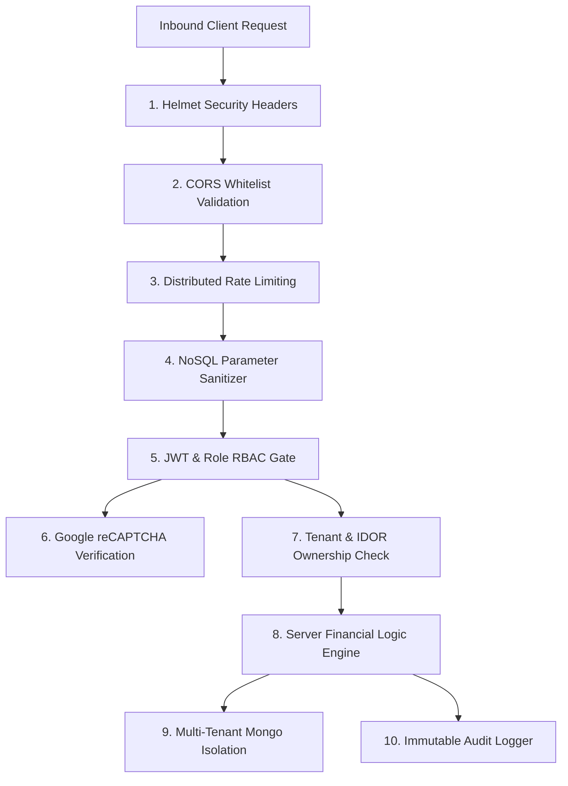

# StayCabs 19-Point Production Security, Hardening & Zero-Trust Audit

**Document ID:** `QA/13_SECURITY_AUDIT`  
**Revision Date:** 2026-11-06  
**Auditor:** Production Security Auditor (Agent 10)  

---

## 1. Executive Security Posture

StayCabs implements a defense-in-depth zero-trust architecture designed for high-concurrency mountain transit and hospitality operations.



---

## 2. 19-Point Security Assessment Matrix

| # | Security Control Domain | Implementation Mechanism | Verified Status |
| :-: | :--- | :--- | :---: |
| **1** | **Multi-Tenant Isolation** | Physical separation between `production` and `test` databases via `tenantDbModel()`. Strict isolation by tenant key (`propertyId`). | **PASS** |
| **2** | **Authentication on API Routes** | All non-public endpoints enforced via `authenticateStayRide` / `verifyToken`. Instant session revocation via `User.tokenVersion`. | **PASS** |
| **3** | **Client Zero-Trust Valuation** | All financial splits, platform fees, advances, and cash balances computed server-side in `CommissionService`. Zero client fare overriding. | **PASS** |
| **4** | **Distributed Rate Limiting** | Shared MongoDB store (`MongoRateLimitStore`) protects auth, signup, and cab requests (30 req / 15m) across auto-scaled serverless instances. | **PASS** |
| **5** | **NoSQL Injection Defense** | Global `mongoSanitize` middleware strips dangerous `$` and `.` operators from `req.body`, `req.query`, and `req.params`. | **PASS** |
| **6** | **Parameterized Schema Validation**| Strict Mongoose schema typing with enum validation and bounded numeric ranges. | **PASS** |
| **7** | **CORS Origin Lockdown** | Origin header verified against strict whitelist (`CORS_ORIGIN`, `guestWebUrl`, `publicApiUrl`). Untrusted origins rejected with 403. | **PASS** |
| **8** | **Security Headers via Helmet** | Content-Security-Policy, X-Frame-Options, Cross-Origin-Resource-Policy, and HSTS enforced via Helmet. | **PASS** |
| **9** | **IDOR Prevention** | Drivers can only access their assigned trips (`walletTrips(driverId)`). Hosts can only access their estate's requests. | **PASS** |
| **10**| **Production Error Masking** | Global `errorHandler` suppresses internal stack traces in deployed environments, returning sanitized `{ error: { message, code } }`. | **PASS** |
| **11**| **Public CAPTCHA Bot Defense** | Google reCAPTCHA v3 (`requireRecaptcha`) required on all anonymous write surfaces (`driver_signup`, `guest_cab_request`, `newsletter`). | **PASS** |
| **12**| **Admin Audit Trail** | Immutable, append-only `auditlogs` collection logs actor ID, action code, target entity, metadata payload, and IP address. | **PASS** |
| **13**| **Boarding PIN Brute-Force Gate** | Boarding PIN attempts tracked in `pickupOtpAttempts`. 5 consecutive failed attempts locks PIN entry, preventing dictionary attacks. | **PASS** |
| **14**| **Private Payout Locks** | Partial compound unique indexes (`one_pending_payout_per_driver`) prevent concurrent double-withdrawal race conditions. | **PASS** |
| **15**| **Webhook Cryptographic Signatures**| Razorpay (HMAC SHA256), Clerk (Svix HMAC), and Meta WhatsApp (App Secret SHA256) verify cryptographic payload signatures. | **PASS** |
| **16**| **File & Body Size Clamping** | Express JSON bodies capped at 1 MB globally; large homestay photo uploads capped strictly at 6 MB with base64 validation. | **PASS** |
| **17**| **Secret Leakage Prevention** | Startup check in `config/env.ts` detects and crashes if `KNOWN_LEAKED_SECRET` is used. All Atlas URIs masked in console logs. | **PASS** |
| **18**| **Permanent Audit Retention** | Startup routine in `db.ts` drops any legacy TTL indexes on `auditlogs`, preventing compliance record deletion. | **PASS** |
| **19**| **Fail-Closed Database Fallback** | In-memory DB fallback strictly disabled in production. Server terminates immediately with 503 if Atlas is unreachable. | **PASS** |

---

## 3. Webhook Signature Verification Details

### 1. Razorpay Payment Gateway Webhook (`routes.ts:1762`)
- **Signature Header:** `x-razorpay-signature`
- **Verification Algorithm:**
  ```typescript
  const expected = crypto.createHmac("sha256", process.env.RAZORPAY_WEBHOOK_SECRET)
    .update(rawBody)
    .digest("hex");
  if (!crypto.timingSafeEqual(Buffer.from(signature), Buffer.from(expected))) {
    throw httpError(401, "Invalid webhook signature", "WEBHOOK_VERIFICATION_FAILED");
  }
  ```
- **Safety:** Uses `crypto.timingSafeEqual` to eliminate timing-attack vulnerabilities.

### 2. Meta WhatsApp Cloud API Webhook (`routes.ts:1798`)
- **Signature Header:** `x-hub-signature-256`
- **Verification Algorithm:** HMAC SHA256 of raw request body using `WHATSAPP_APP_SECRET`. Verified before processing delivery receipts or inbound text replies.

### 3. Clerk Authentication Webhook (`routes.ts:1812`)
- **Signature Headers:** `svix-id`, `svix-timestamp`, `svix-signature`
- **Verification Algorithm:** Svix Webhook standard verification using `CLERK_WEBHOOK_SIGNING_SECRET`. Prevents spoofed user account synchronization.
