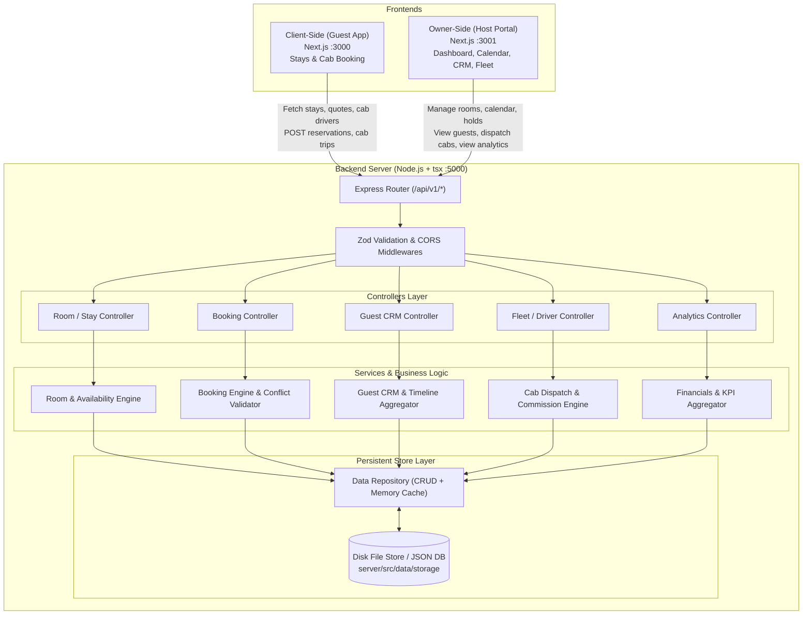

# 01 - Backend Architecture & Technical Design

## 1. Runtime & Technology Stack

The backend will reside at:
```
/Users/tirtharaj/Desktop/Desktop/github/nakh/server
```

| Component | Technology | Version / Tool | Purpose |
| :--- | :--- | :--- | :--- |
| **Runtime** | Node.js | `v22.13.1` | Modern ECMAScript, native fetch, crypto |
| **Language** | TypeScript | `^5.x` | Strict typing shared across client, owner & server |
| **Execution Engine** | `tsx` | `latest` (`npx tsx watch`) | Instant TypeScript execution without manual compilation steps |
| **HTTP Server** | Express | `^4.21` or `^5` | Standard, robust, battle-tested REST server |
| **Data Validation** | Zod | `^3.23` | Runtime schema validation for API request bodies and query parameters |
| **CORS** | `cors` | `^2.8` | Cross-Origin Resource Sharing for `localhost:3000` (client) and `localhost:3001` (owner) |
| **Persistence Layer** | File-backed JSON / SQLite Repository | Clean Repository Pattern | Atomic persistence with disk durability and automated seed hydration |
| **Logging** | `morgan` / Custom Logger | Built-in | Structured request logging with timings |

---

## 2. Directory Structure (`/server`)

```
/server
├── package.json
├── tsconfig.json
├── .env.example
├── src
│   ├── config
│   │   └── env.ts                 # Validated environment configuration (PORT, CORS origins)
│   ├── types
│   │   ├── estate.ts              # Estate, Location & Profile types
│   │   ├── room.ts                # Room units & stay models
│   │   ├── booking.ts             # Reservation & booking models
│   │   ├── guest.ts               # Guest CRM models
│   │   ├── driver.ts              # Drivers & cab trips models
│   │   └── analytics.ts           # Financial & operations KPI metrics
│   ├── data
│   │   ├── db.ts                  # Persistent storage engine with JSON file store & disk flush
│   │   ├── seeds
│   │   │   ├── rooms.seed.ts      # Merged 6 estate units (client stays + owner roomUnits)
│   │   │   ├── drivers.seed.ts    # Merged driver roster (Dipu, Saraswati, Bikash, etc.)
│   │   │   ├── profile.seed.ts    # Gumtree Valley / Meadowfall estate info
│   │   │   ├── bookings.seed.ts   # Initial calendar bookings
│   │   │   └── guests.seed.ts     # Initial guest CRM records
│   │   └── storage/               # Runtime persisted database files (gitignored or committed initial)
│   ├── schemas
│   │   ├── booking.schema.ts      # Zod validation schemas for booking & quotes
│   │   ├── room.schema.ts         # Zod validation for room creation / maintenance holds
│   │   └── driver.schema.ts       # Zod validation for driver additions & status updates
│   ├── services
│   │   ├── property.service.ts    # Property profile & locations logic
│   │   ├── room.service.ts        # Rooms inventory, availability calendar & pricing quotes
│   │   ├── booking.service.ts     # Reservation creation, conflicts check, door PIN generation
│   │   ├── guest.service.ts       # Guest CRM queries, search, tag updates, timeline aggregation
│   │   ├── driver.service.ts      # Fleet status, driver assignment, trip fares, commission
│   │   └── analytics.service.ts   # Dynamic revenue timeline, occupancy %, ADR, service margins
│   ├── controllers
│   │   ├── property.controller.ts
│   │   ├── room.controller.ts
│   │   ├── booking.controller.ts
│   │   ├── guest.controller.ts
│   │   ├── driver.controller.ts
│   │   └── analytics.controller.ts
│   ├── routes
│   │   ├── index.ts               # Central router mounting /api/v1/*
│   │   ├── property.routes.ts     # /api/v1/properties
│   │   ├── room.routes.ts         # /api/v1/rooms, /api/v1/stays
│   │   ├── booking.routes.ts      # /api/v1/bookings, /api/v1/reservations
│   │   ├── guest.routes.ts        # /api/v1/guests
│   │   ├── driver.routes.ts       # /api/v1/drivers, /api/v1/cabs
│   │   └── analytics.routes.ts    # /api/v1/analytics
│   ├── middlewares
│   │   ├── error-handler.ts       # Centralized error formatter
│   │   ├── not-found.ts           # 404 handler
│   │   └── validate.ts            # Zod request validation middleware
│   ├── app.ts                     # Express app configuration & middlewares
│   └── server.ts                  # Server bootstrap & listen logic
```

---

## 3. High-Level Architecture Flow



---

## 4. Key Architectural Decisions

1. **Port Allocation**:
   - `client-side`: `http://localhost:3000`
   - `owner-side`: `http://localhost:3001`
   - `server`: `http://localhost:5000` (configurable via `PORT` env var).
2. **Unified Data Model**:
   - The client-side refers to accommodations as `Stay` (slug-based).
   - The owner-side refers to accommodations as `RoomUnit` (code-based like `101`, `201`).
   - The backend maps both seamlessly: each room has an immutable `id`, a unique `code` (e.g. `101`), and an SEO-friendly `slug` (e.g. `ging-tea-cottage`). This bridges `client-side` and `owner-side` without breaking either frontend!
3. **Persistent Data Storage**:
   - To make it zero-friction to run immediately without requiring external database server installations (e.g. Docker / PostgreSQL setup), we will use an asynchronous, atomic file-backed JSON store with in-memory indexes.
   - When seeded on first run, it hydrates rich demo data matching the client and owner apps.
   - Every mutation is atomically persisted to disk so bookings and changes survive restarts.
   - The service interface uses an abstraction (`IRepository`), allowing instant swap to Prisma/PostgreSQL or SQLite whenever desired.
4. **Instant Synchronization**:
   - When a guest submits a reservation on `client-side`, the booking record is saved, dates are marked unavailable in the calendar, a guest record is created/updated in the CRM, and owner analytics KPIs immediately update.
