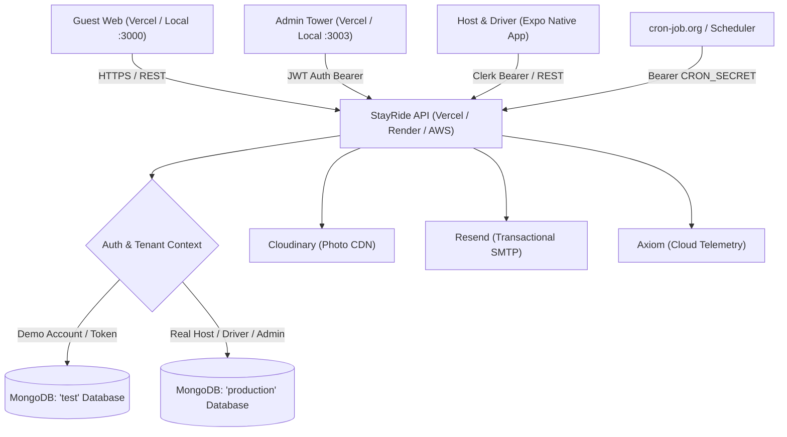

# StayRide v2.0 - Deployment & Environment Architecture Master Guide

> **Target Audience**: Core engineering, DevOps, and future maintainers.  
> **Last Updated**: October 2026  
> **Status**: Verified Production & Vercel Serverless Ready  

---

## 1. Architecture Overview

StayRide is a multi-sided travel and homestay transit platform comprising:
1. **Server API**: Express.js with TypeScript running as a Vercel Serverless Function (`api/index.ts`) or standalone Node.js server (`src/server.ts`).
2. **Platform Admin Portal**: Next.js dashboard deployed at `https://home-stay-admin.vercel.app` (local: `:3003`).
3. **Guest & Client Web Portal**: Next.js portal deployed at `https://home-stay-p5rg.vercel.app` (local: `:3000`).
4. **Mobile App**: React Native / Expo app for homestay hosts and cab drivers.
5. **Database Layer**: Multi-tenant MongoDB Atlas cluster with physical database separation.



---

## 2. Environment Variables Matrix

Every variable configured in `.env` is documented below with its role, current production value, and fallback behavior:

| Variable | Current Production Value | Purpose & Fallback Behavior |
| :--- | :--- | :--- |
| `NODE_ENV` | `production` | Enables production security, Helmet protections, and error masking. |
| `PORT` | `5050` | Port for local standalone dev (`npm run dev`). Ignored on Vercel (Vercel sets dynamic internal ports). |
| `MONGODB_URI` | `mongodb+srv://...` | Connection string to MongoDB Atlas. Throws fatal error on startup if missing. |
| `MONGODB_DATABASE` | `production` | Physical database name for all real homestays, trips, and transactions. |
| `MONGODB_DATABASE_PREVIEW` | `preview` | Safety database used automatically by Vercel PR preview deployments so previews never touch production. |
| `ALLOW_LOCAL_PRODUCTION_DB`| `true` | Safeguard: outside Vercel, scripts refuse to write to `production` unless this is `true`. Vercel ignores this. |
| `DEMO_ENABLED` | `true` | **Critical**: on Vercel (`process.env.VERCEL`), demo logins are blocked unless this is explicitly `true`. Routes to `test` DB. |
| `CORS_ORIGIN` | Single comma-separated list | Allowed browser origins. Covers all deployed Vercel frontends + local development ports (`3000`–`3003`, `5500`, `5501`). |
| `GUEST_WEB_URL` | `https://home-stay-p5rg.vercel.app` | Base URL used when generating guest cab-booking tracking links sent via WhatsApp/SMS. |
| `PUBLIC_API_URL` | `https://home-stay-ten.vercel.app` | Public base URL used when generating calendar export feed links (Airbnb / Booking.com iCal). |
| `JWT_SECRET` | 64-char hex string | Signs internal admin & driver session tokens. Code throws fatal error if empty or default. |
| `JWT_EXPIRES_IN` | `15m` | Token validity lifetime. Forces token refresh to maintain tight session security. |
| `CLERK_PUBLISHABLE_KEY` | `pk_test_...` / `pk_live_...` | Public key used by frontend and mobile apps for Clerk OAuth authentication. |
| `CLERK_SECRET_KEY` | `sk_test_...` / `sk_live_...` | Backend secret key used by Express to verify bearer tokens and query user profiles from Clerk. |
| `CLERK_WEBHOOK_SIGNING_SECRET` | `whsec_...` | Verifies incoming webhooks at `/v1/auth/clerk-webhook` to sync account status changes. |
| `CRON_SECRET` | 32-char secret token | Secures `GET /v1/cron/ical-sync`. Requests must send `Authorization: Bearer <CRON_SECRET>`. |
| `PAYMENT_GATEWAY_MODE` | `simulation` | When `simulation`, advance payments validate instantly with mock TXNs. Change to `razorpay` for live gateway. |
| `RAZORPAY_KEY_ID` | `rzp_test_placeholder` | Razorpay Key ID. Dormant while `PAYMENT_GATEWAY_MODE=simulation`. |
| `RAZORPAY_KEY_SECRET` | `rzp_secret_placeholder` | Razorpay Key Secret. Dormant while `PAYMENT_GATEWAY_MODE=simulation`. |
| `RAZORPAY_WEBHOOK_SECRET` | `rzp_whsec_placeholder` | Verifies `payment_link.paid` webhook signatures. Dormant while in simulation. |
| `WHATSAPP_DISPATCH_MODE`| `native_link` | Generates direct `wa.me/` URLs from device. Dormant until switched to `cloud_api`. |
| `WHATSAPP_PHONE_NUMBER_ID` | `none` | Meta WhatsApp Phone Number ID. Dormant while `native_link` is active. |
| `WHATSAPP_ACCESS_TOKEN` | `none` | Meta System User Access Token. Dormant while `native_link` is active. |
| `WHATSAPP_API_VERSION` | `v21.0` | Meta Graph API version for WhatsApp Cloud API. |
| `PUSH_DISABLED` | `false` | When `false`, Expo mobile push notifications are sent to driver and host devices. |
| `CLOUDINARY_CLOUD_NAME` | Configured / `disabled` | Cloudinary cloud identifier for CDN photo uploads. |
| `CLOUDINARY_API_KEY` | Configured / `disabled` | Cloudinary API Key. |
| `CLOUDINARY_API_SECRET` | Configured / `disabled` | Cloudinary API Secret for SHA-1 upload signature generation. |
| `SMTP_HOST` | `smtp.resend.com` | SMTP host for transactional emails. |
| `SMTP_PORT` | `587` | SMTP port. |
| `SMTP_SECURE` | `false` | TLS handshake mode (false for STARTTLS on port 587). |
| `SMTP_USER` | `resend` | SMTP username. |
| `SMTP_PASS` | `re_...` | SMTP API key / password. |
| `SMTP_FROM` | `"StayRide" <onboarding@resend.dev>` | Email sender. Uses Resend sandbox until custom domain is DNS-verified. |
| `AXIOM_TOKEN` | `xaat-...` | Axiom ingest API token for zero-DB-impact log streaming. |
| `AXIOM_DATASET` | `stayride-api` | Dataset name in Axiom dashboard where logs are stored and indexed. |
| `LOGTAIL_SOURCE_TOKEN` | `disabled` | Alternative log shipper (Better Stack). Disabled in favor of Axiom. |

---

## 3. Key Fixes & Design Decisions Implemented

### A. Purging Dead / Obsolete Variables
1. **`SUPER_ADMIN_EMAIL`**: Removed. The codebase queries administrators dynamically from the MongoDB `User` collection where `role === "admin"`.
2. **`DEFAULT_ADVANCE_AMOUNT`**: Removed. Advance percentage and minimum amounts are controlled dynamically in MongoDB via `CommissionSettings` and updated live through the Admin Tower.
3. **`GOOGLE_CLIENT_ID` & `ALLOW_DEV_OAUTH_MOCK`**: Removed. Clerk manages Google OAuth directly on Clerk's servers and issues Clerk tokens.
4. **`ALLOW_SEED` & `SEED_PASSWORD`**: Removed. Seeding is hard-blocked on Vercel. Removing them prevents accidental database wipes.
5. **`LEGACY_API_ENABLED`**: Removed. When omitted, it safely defaults to `false`.

### B. Overcoming Vercel's "No Blank Values" Rule
Vercel rejects any environment variable with an empty value (`KEY=`). To allow storing dormant/future service keys in Vercel without validation errors:
* We enhanced `CloudinaryService`, `NotificationService`, and `TelemetryLogger` to treat `"disabled"`, `"none"`, and `"placeholder"` as unconfigured.
* Result: Vercel accepts all variables, and the server runs cleanly without failed network requests.

### C. Resolving the Serverless Function Build Error (TS7016)
* **The Error**: `api/index.ts: error TS7016: Could not find a declaration file for module '../dist/app.js'`
* **The Root Cause**: `api/index.ts` was attempting a dynamic import of compiled JavaScript files in `dist/` which lacked `.d.ts` declaration files.
* **The Fix**: Pointed `api/index.ts` directly to source TypeScript files (`import app from "../src/app.js"`), and enabled `"declaration": true` in `tsconfig.json`.

---

## 4. Multi-Tenant Database Isolation (Production vs. Demo)

The codebase implements zero-cross-contamination multi-tenancy using Mongoose `useDb`:

```typescript
// src/config/env.ts
export const dbNameFor = (isDemo: boolean) => (isDemo ? "test" : liveDbName());

// src/utils/tenant-model.ts
export function tenantDbModel(isDemo: boolean, name: string, schema: Schema) {
  const conn = mongoose.connection.useDb(dbNameFor(isDemo), { useCache: true });
  return conn.model(name, schema);
}
```

* **Live Data**: Always written to `MONGODB_DATABASE=production`.
* **Demo Data**: All demo logins (`demo@stayride.in`, demo driver accounts) are flagged with `isDemo: true` in their JWT payload. Their queries are strictly routed to the `"test"` database.
* **Vercel Flag**: `DEMO_ENABLED=true` ensures demo testing works live on Vercel while keeping production customer data untouched.

---

## 5. Platform Migration Runbook

If you migrate from Vercel to another hosting provider or database, follow this checklist:

### A. Migrating to Render (Web Service)
1. **Repository**: Connect your GitHub repository to Render.
2. **Environment**: Choose **Node**.
3. **Root Directory**: `server` (or `my-code/server`).
4. **Build Command**: `npm install && npm run build`
5. **Start Command**: `node dist/server.js` (uses standalone Express server, not `api/index.ts`).
6. **Environment Variables**: Copy the exact `.env` file into Render's Environment tab.
7. **Port**: Render automatically injects `PORT=10000`; `src/server.ts` automatically binds to `process.env.PORT`.

### B. Migrating to AWS (App Runner or ECS Fargate)
1. **Dockerfile**: Create a `Dockerfile` in `server/`:
   ```dockerfile
   FROM node:20-alpine AS builder
   WORKDIR /app
   COPY package*.json tsconfig.json ./
   RUN npm ci
   COPY src/ ./src/
   RUN npm run build

   FROM node:20-alpine AS runner
   WORKDIR /app
   ENV NODE_ENV=production
   COPY package*.json ./
   RUN npm ci --omit=dev
   COPY --from=builder /app/dist ./dist
   EXPOSE 5050
   CMD ["node", "dist/server.js"]
   ```
2. **AWS Systems Manager / Secrets Manager**: Store `MONGODB_URI`, `JWT_SECRET`, and Clerk keys securely in AWS Parameter Store or Secrets Manager.
3. **Load Balancer (ALB)**: Route traffic to target group port `5050` with health check path `/health`.
4. **Update URLs**: Update `PUBLIC_API_URL` to your custom domain or CloudFront distribution URL.

### C. Migrating / Changing the Database
1. **New MongoDB Atlas Cluster**:
   * Obtain the new connection string (`mongodb+srv://...`).
   * Add `0.0.0.0/0` to **Network Access** in the new Atlas cluster.
   * Update `MONGODB_URI` in Vercel / Render / AWS.
   * Re-create your platform admin in the new database:
     ```bash
     ADMIN_EMAIL=admin@stayride.in ADMIN_PASSWORD='YourPassword123!' ALLOW_LOCAL_PRODUCTION_DB=true npx tsx scripts/create-admin.ts
     ```
2. **Relational Database (e.g., PostgreSQL)**:
   * The codebase currently uses Mongoose models with custom schemas (`src/models/`).
   * If migrating to SQL (Prisma / Drizzle), you will need to replace Mongoose schemas with an ORM schema matching `docs/02_DATA_SCHEMA.md`.

---

## 6. Future Third-Party Activation Checklist

When you are ready to switch from testing to live third-party services, update these specific variables:

### 1. Activating Live Razorpay Payments
1. Complete KYC in [Razorpay Dashboard](https://dashboard.razorpay.com).
2. Generate Live API Keys (**Account & Settings → API Keys**).
3. Update environment variables:
   * `PAYMENT_GATEWAY_MODE=razorpay`
   * `RAZORPAY_KEY_ID=rzp_live_...`
   * `RAZORPAY_KEY_SECRET=<live-secret>`
4. Add Webhook in Razorpay:
   * **URL**: `https://<your-api-domain>/v1/webhooks/razorpay`
   * **Event**: `payment_link.paid`
   * **Secret**: Set into `RAZORPAY_WEBHOOK_SECRET`.

### 2. Activating Meta WhatsApp Cloud API
1. In [Meta Developers](https://developers.facebook.com), create a Business App and add WhatsApp.
2. Generate a permanent System User Token with `whatsapp_business_messaging` permissions.
3. Update environment variables:
   * `WHATSAPP_DISPATCH_MODE=cloud_api`
   * `WHATSAPP_PHONE_NUMBER_ID=<your-meta-phone-id>`
   * `WHATSAPP_ACCESS_TOKEN=<your-system-user-token>`

### 3. Adding a Custom Domain
1. In Vercel, attach your domains (e.g. `api.stayride.in`, `admin.stayride.in`, `stayride.in`).
2. Update `.env`:
   * `GUEST_WEB_URL=https://stayride.in`
   * `PUBLIC_API_URL=https://api.stayride.in`
   * `CORS_ORIGIN=https://admin.stayride.in,https://stayride.in,http://localhost:3000,http://localhost:3003...`
3. In [Resend Domains](https://resend.com/domains), verify `stayride.in` via DNS TXT/MX records, then update:
   * `SMTP_FROM="StayRide" <no-reply@stayride.in>`
